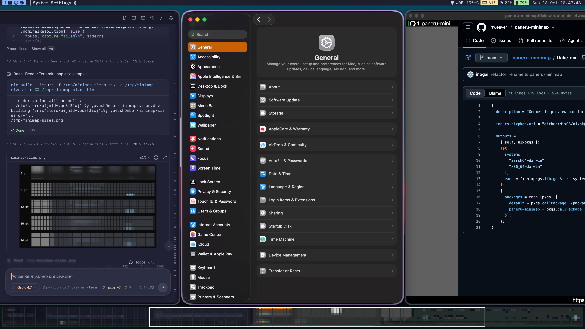

# paneru-minimap

A Darwin menu-bar-less panel for the running paneru strip. It is a paneru client. It does not capture the desktop as a second status bar.

One block per tiled column, laid out in paneru's column order and each sized by its own window, so a window parked past the display edge keeps its block instead of merging with its neighbours. The whole window is scaled into that block and drawn as 9×6 pt minimap cells, so a taller window shows more, compressed, instead of a top crop. The strip is scaled so the current display takes `displayFraction` of the bar width, which leaves the neighbouring columns visible; a strip wider than that shrinks further, until every column fits. Unfocused columns are dimmed. A white stroke marks the part of the strip that lies on the current display. A click runs `paneru send-cmd window focus <column>`.



Screen Recording permission is required before the cells show window content. The first launch prompts for it.

## Nix

```
nix build github:4weaver/paneru-minimap
./result/Contents/MacOS/paneru-minimap
```

The output is an app bundle. The executable is `Contents/MacOS/paneru-minimap`. It links only system frameworks and `/usr/lib/swift`, so the bundle does not need the Nix store at runtime.

Home Manager: import `homeManagerModules.default`, then set `services.paneru-minimap.enable`. This is a launchd agent, so it lives under `services`, not `programs`. The module does nothing unless the host is Darwin. It starts at login and restarts if it dies.

```nix
{
  inputs.paneru-minimap.url = "github:4weaver/paneru-minimap";
}
```

Add `paneru-minimap.homeManagerModules.default` to `imports`, then:

```nix
services.paneru-minimap.enable = true;
```

## Without Nix

Copy the built bundle out of the store and open it:

```
cp -R $(nix build github:4weaver/paneru-minimap --print-out-paths) /Applications/Paneru-minimap.app
open /Applications/Paneru-minimap.app
```

After that, Nix is not required to run it.

To compile without Nix, the Xcode Command Line Tools must provide `swiftc` and `codesign`:

```
mkdir -p Paneru-minimap.app/Contents/MacOS Paneru-minimap.app/Contents/Resources
cp config.json Paneru-minimap.app/Contents/Resources/config.json
swiftc -O -parse-as-library \
  -o Paneru-minimap.app/Contents/MacOS/paneru-minimap \
  Sources/Layout.swift Sources/App.swift \
  -framework AppKit -framework CoreGraphics
codesign -f -s - -i com.inogai.paneru-minimap Paneru-minimap.app
open Paneru-minimap.app
```

That bundle has no `Info.plist`. Add one if macOS does not show the app in the Screen Recording list. `LSUIElement` must be true, and `CFBundleIdentifier` must be `com.inogai.paneru-minimap`.

## Settings

`config.json` in the bundle, then `~/.config/paneru-minimap/config.json` if that file exists. Later files win.

| key | default | |
| --- | --- | --- |
| `barHeight` | 64 | panel height, pt |
| `screenInset` | 8 | gap above the bottom of the screen, pt |
| `cellWidth` | 9 | minimap cell width, pt |
| `cellHeight` | 6 | minimap cell height, pt |
| `unfocusedShade` | 0.72 | dim on unfocused columns |
| `unfocusedWash` | 0.18 | dark wash on unfocused columns |
| `displayFraction` | 0.3 | share of the bar width the current display takes, so the bar shows the strip around it; the columns win when they need the room |
| `filter` | `minimap` | `none` or `minimap` |
| `shape` | `square` | `square` or `dot`, used by `minimap` |
| `sharing` | `readOnly` | `readOnly` shows the bar in screenshots and screen share; `none` hides it |

Restart the process after changing the file. The file is read once at launch.
